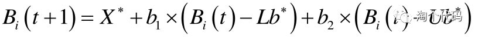
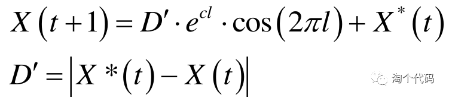
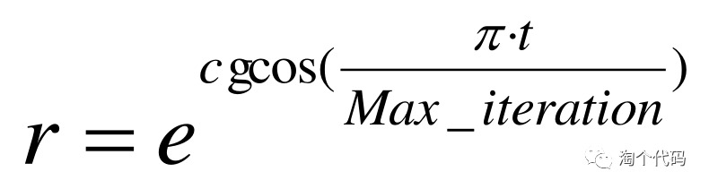
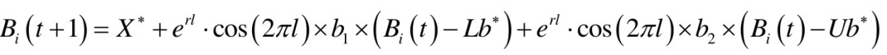
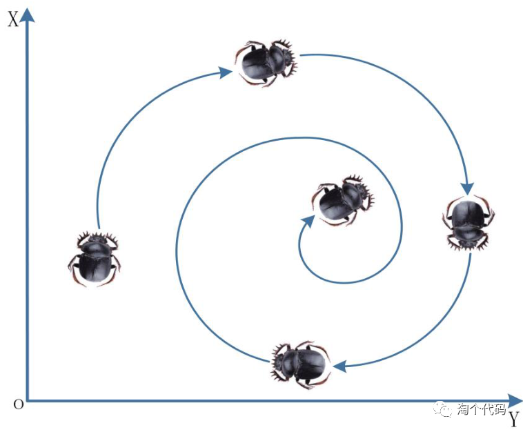
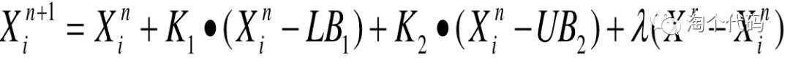
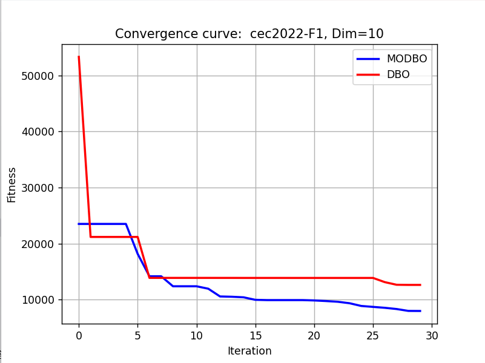
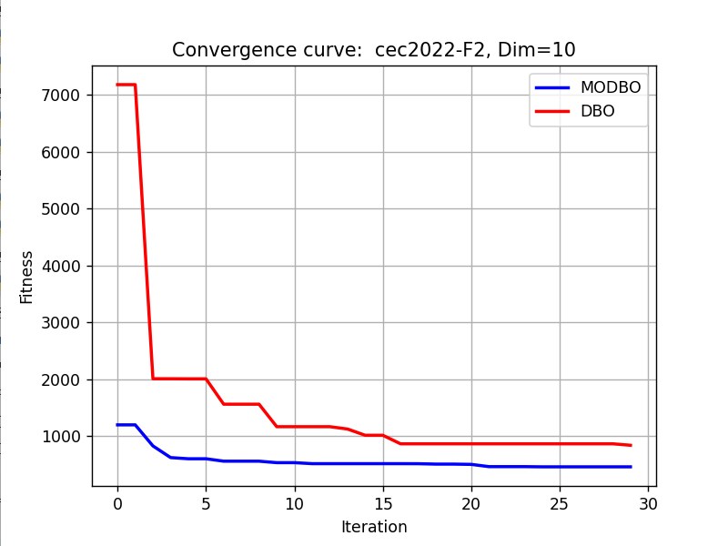

# Improved Dung Beetle Python Code(Spiral search+Optimal Value Guidance+Lens inverse learning)

① Spiral search strategy
In the Dung Beetle Optimization (DBO) algorithm,  If the eggs are being laid in the current breeding area, This will certainly lead to the population converging rapidly in a short period of time. However, it can also lead to a decrease in population diversity. Easy to make the algorithm fall into local optimum; Therefore, the formula for the reproduction phase of the dung beetle algorithm is improved.
Inspired by the foraging behavior of the killer whales in the whale algorithm, during iterations, individual whales use a spiral search strategy to update their positions relative to the prey. This not only ensures the convergence speed of the algorithm but also increases the diversity of individuals. The formula for the whale hunting phase is as follows:
However, this strategy is easily affected by the parameter c. A larger c will cause the algorithm to decay too quickly, resulting in local optimality, while a smaller c will lead to slow convergence of the algorithm. To address this issue, the dynamic spiral search shape parameter r has been introduced.
The Dung Beetle algorithm is improved by using a spiral search strategy during the reproduction phase. The updated Dung Beetle algorithm formula is as follows:
The following is the diagram of Dung Beetle's search path at this time:
② Optimal Value Guidance Strategy
In the foraging phase of the dung beetle algorithm,  The generation of candidate solutions is influenced by two random numbers (K1 and K2). This makes the probability of generating better and worse candidate solutions equal. Guide the generation of candidate solutions by introducing the current optimal value. The new formula is as follows.
③Lens imaging inverse learning strategy
The main idea of lens imaging inverse learning is to generate a reverse position based on the current coordinates through the principle of convex lens imaging to expand the search range. This can both escape the current position, It can further expand the search range of the dung beetle algorithm., Increased the diversity of Dung Beetle populations. The reverse learning formula based on the principle of lens imaging is as follows:
The required packages are:
matplotlib~=3.8.2\nnumpy~=1.26.3\nscipy~=1.12.0\nopfunu~=1.0.1\n  
Results Display
Utilizing the powerful opfunu library in Python, we have integrated 11 CEC function libraries including CEC2005/2008/2010/2013.

## Images

<!-- PAYMENT_BLOCK -->

## Get this dataset

- Payment link (Stripe): [Buy now](https://buy.stripe.com/3cs8yP7sY87d0vu9AB)
- Payment QR code: 

<!-- /PAYMENT_BLOCK -->
